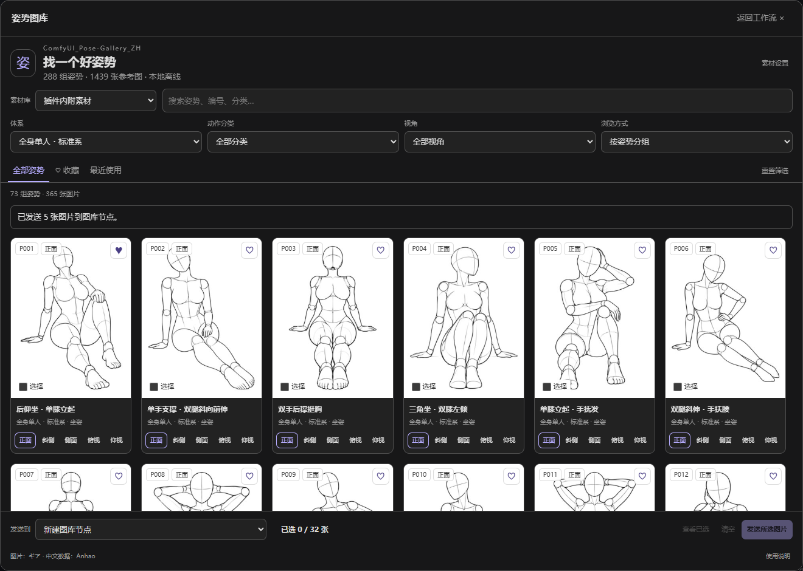

# ComfyUI_Pose-Gallery_ZH

在 ComfyUI 内搜索姿势、切换视角、选图，直接发送到工作流。

**288 组姿势 · 1,439 张参考图 · 内附素材 · 离线使用 · 单图与批量输出**



基于 [Anhao 的中文姿势图库](https://github.com/anhao/ai-pose-gallery-zh) 制作。图片与原始数据来自 [ギア / giaaibusi](https://x.com/giaaibusi)。源代码和素材的使用范围分别见 [LICENSE](LICENSE)。

## 安装

下载本仓库 ZIP 并解压，将文件夹重命名为 **ComfyUI_Pose-Gallery_ZH**，放入下面的目录：

```text
ComfyUI/custom_nodes/ComfyUI_Pose-Gallery_ZH/
├── __init__.py
├── nodes.py
├── js/
├── data/pose-zh.json
├── img/
└── thumbs/
```

也可以在 `custom_nodes` 目录中克隆本仓库：

```bash
git clone https://github.com/Stone-dielianhua/ComfyUI_Pose-Gallery_ZH.git
```

重启 ComfyUI，刷新浏览器。左侧会出现「ComfyUI_Pose-Gallery_ZH」，节点搜索中可找到「姿势图库 · 单图」和「姿势图库 · 批量」。

素材约 **659.5 MB**，包括 1,439 张 PNG 原图和 1,439 张 JPG 缩略图。仅复制代码会导致图片缺失。使用 ComfyUI 已有的 Pillow、NumPy、PyTorch 和 aiohttp，日常安装无需 npm、额外依赖或推理模型。

已验证：**ComfyUI 0.43.0、前端 1.57.6、Python 3.12**。建议使用支持自定义侧栏的现代前端。若旧前端没有侧栏入口，可尝试从节点的「打开姿势图库」进入；其他版本尚未实际验证。

## 使用

1. 打开左侧「ComfyUI_Pose-Gallery_ZH」，搜索中文关键词或编号，组合筛选体系、分类和视角。
2. 点击图片进入大图预览，确认视角后点击「使用此姿势」，默认新建单图节点。
3. 将节点的「图片」输出连接到「预览图像」、保存图像或其他图片处理节点，点击运行。

已有图库节点时，先在底部「发送到」选择它，或从该节点的「打开姿势图库」进入。更新图片会保留连线、尺寸和翻转设置。输入由连线控制时会提示先断开该输入或新建节点。

点击「展开」打开大选图器；侧栏已选图片会带入，关闭时同步回来。支持按姿势分组和逐张浏览、原图下载、复制图片 ID。

### 批量与多角度

勾选图片后点击「发送所选图片」，默认新建批量节点，按选择顺序输出。「查看已选」可检查和移除图片。

大图中可选择某个姿势的全部已有角度。批量节点也提供「当前姿势全部角度」模式，以「图片 ID」所属姿势为准。默认视角顺序：正面 → 斜侧 → 侧面 → 俯视 → 仰视。缺失视角会禁用；内附素材有一组缺少仰视。

每批最多 **32 张**，输出总像素最多 **3,200 万**。批量默认等比留边到 768×1024。原始尺寸模式下图片尺寸不一致时，会提示切换尺寸处理方式。

### 收藏与保存

- 收藏精确到单张视角；收藏与最近使用保存在当前浏览器，不随工作流分享。
- 工作流保存图片 ID、素材库、尺寸和翻转参数。使用内附素材的工作流可在其他安装本插件的电脑上读取同一图片。
- 自定义素材工作流需要接收者配置自己的目录，并保持素材 ID 一致。
- `/` 聚焦搜索；大图中 `← / →` 切换角度、`↑ / ↓` 切换姿势、`Esc` 关闭；触屏可左右滑动。

## 节点参数

| 节点 | 输出 |
| --- | --- |
| 姿势图库 · 单图 `PoseGalleryImage` | IMAGE、图片 ID、姿势说明 |
| 姿势图库 · 批量 `PoseGalleryBatch` | IMAGE 批次、信息清单 JSON |

共同参数：

| 参数 | 说明 |
| --- | --- |
| 素材库 | 默认内置素材库，可选择已配置的自定义素材库 |
| 图片 ID | 图库自动填写，也可手动指定 |
| 尺寸处理 | 原始尺寸／等比留边／居中裁剪／拉伸 |
| 宽度、高度 | 非原始尺寸模式生效，64～4096 |
| 水平翻转 | 左右翻转输出图像 |

等比留边保持比例、空白补白色；居中裁剪保持比例并裁去溢出部分；拉伸直接改为目标尺寸。透明图片先合成到白色背景。单图默认原始尺寸，内附原图为 900×1200。

批量额外提供「图片 ID 清单」「选择方式」「排列顺序」。手动清单支持换行、空格和中英文逗号／分号，自动去重。信息清单记录 ID、体系、编号、名称、分类、角度、输出尺寸和翻转参数，与 IMAGE 批次逐张对应。

## 素材目录

默认使用插件内的 `data/`、`img/`、`thumbs/`，**不依赖开发者电脑上的其他目录**。

自定义素材：点击图库「素材设置」→ 填写绝对路径 →「检查并保存」→ 在图库顶部选择「自定义素材目录」。节点也应选择「自定义素材库」。保存前校验清单结构、ID 和原图存在性；错误配置不会覆盖原有效设置。清空并保存可取消自定义目录。

路径属于 **ComfyUI 运行的电脑**。设置保存在 ComfyUI 用户目录的 `pose_gallery/settings.json`，不会写入共享工作流或插件源码。切换浏览来源不会改写已有节点。

目录结构和 JSON 示例见 [自定义素材说明](docs/custom-assets.md)。第一版通过目录和清单管理自定义素材，可在文件管理器中维护图片。

## 用于控制生成姿势

插件输出**人物参考图**，不直接提取骨架或关键点。典型接法：

```text
姿势图库 · 单图 → DWPose / OpenPose → 姿势 ControlNet → 采样 → 解码 → 保存
```

骨架预处理需要另装 [comfyui_controlnet_aux](https://github.com/Fannovel16/comfyui_controlnet_aux)，首次运行可能下载预处理模型。ControlNet 生成另需基础模型和匹配的姿势 ControlNet 权重。双人、遮挡、手指、特殊视角的检测效果取决于预处理模型，建议先预览骨架。

## 示例工作流

将 JSON 拖入 ComfyUI：

| 文件 | 内容 | 额外要求 |
| --- | --- | --- |
| [01_single_image.json](examples/01_single_image.json) | 单图 → 预览，已实测运行 | 无 |
| [02_batch_all_angles.json](examples/02_batch_all_angles.json) | 全部视角 → 预览，已实测输出 5 张 | 无 |
| [03_dwpose_preview.json](examples/03_dwpose_preview.json) | 参考图 → DWPose → 骨架预览 | controlnet_aux 和预处理模型 |
| [04_controlnet_template.json](examples/04_controlnet_template.json) | DWPose + ControlNet 完整生成接线 | 选择自己的基础模型与 ControlNet |

第四个以 **SD1.5、512×768** 为模板，模型名称为占位提示，运行前须选择本机互相匹配的模型。第三、四个已核对节点接口和连线，未执行模型推理或扩散采样。

## 常见问题与开发

- 入口未出现：确认 `__init__.py` 直接位于插件目录，没有多嵌套一层；重启 ComfyUI 并刷新浏览器，检查加载日志。
- 图片缺失：检查素材是否完整。可运行 `python -X utf8 scripts/verify.py`。自定义缩略图缺失会回退原图。
- ID 不存在：检查节点素材库来源及对应清单。无效 ID 不会被替换为其他姿势。
- 后端检查：使用 ComfyUI 的 Python 运行 `python -m unittest discover -s tests -v`。
- 前端检查：Node.js 22 以上运行 `node --test tests/frontend.test.mjs`。

详细验证记录和浏览器测试方式见 [测试说明](docs/testing.md)。

## GitHub 发布与授权

GitHub 仓库为 [Stone-dielianhua/ComfyUI_Pose-Gallery_ZH](https://github.com/Stone-dielianhua/ComfyUI_Pose-Gallery_ZH)，包含插件代码及全部内附素材。申请 Comfy Registry 发布时需填写自己的 PublisherId；本版本尚未发布到 Registry。

保留上游授权范围：**源代码使用 MIT；图片和原始数据不属于 MIT 授权范围，原仓库注明不得用于商业用途**。插件开源不会改变素材的使用限制，详见 [LICENSE](LICENSE)。

本文件夹是可独立安装和发布的插件项目；原静态站点属于上游项目，历史说明已存档至 [docs/ORIGINAL_README.md](docs/ORIGINAL_README.md)。
